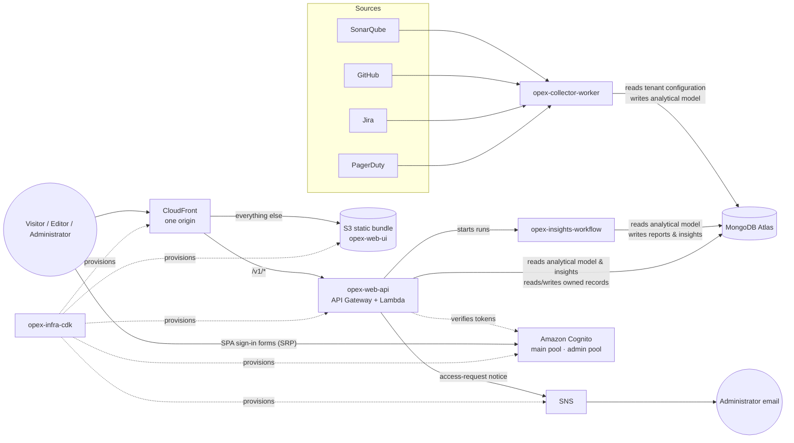
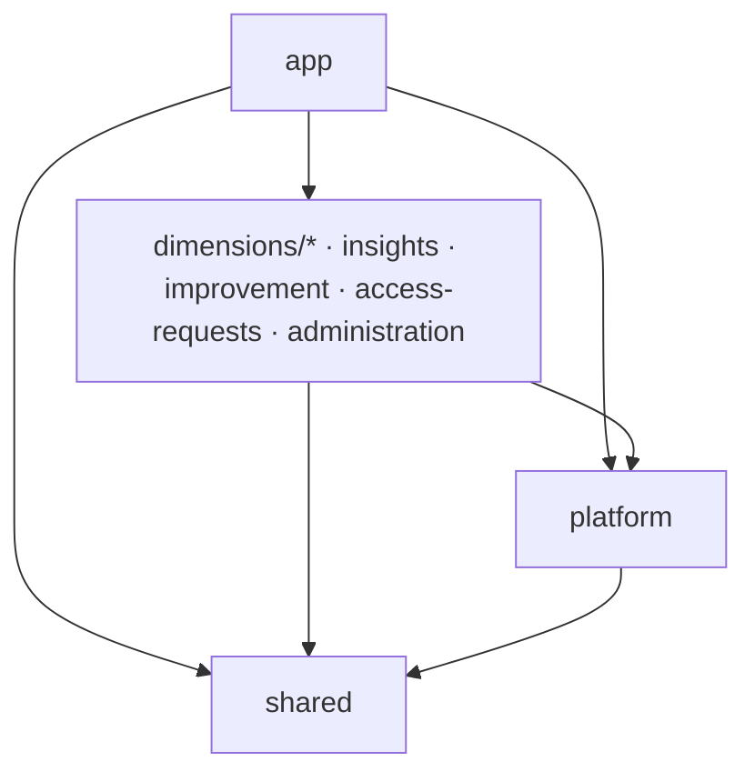
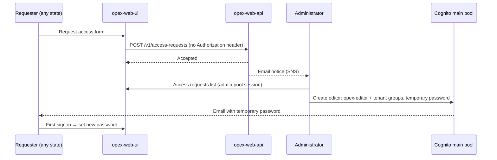
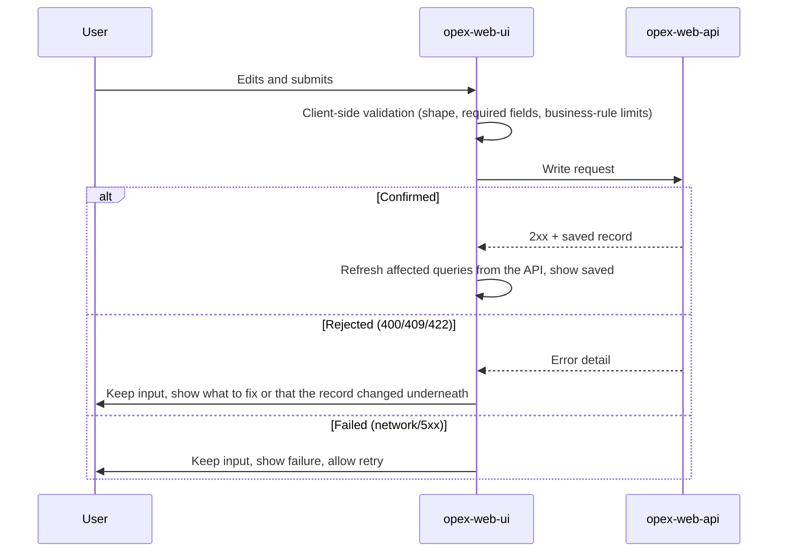
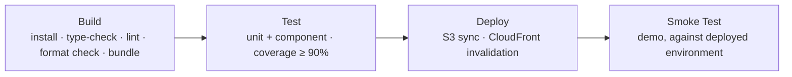

# High-Level Design: opex-web-ui

## Problem

Engineering teams generate operational signals in many separate systems: code quality in SonarQube, pull-request activity and test coverage in GitHub, ticket flow in Jira, incident response in PagerDuty. Each system reports in its own vocabulary, at its own granularity, behind its own UI. An analyst who wants to answer "how is this team doing, and is it getting better?" has to visit each tool, reconcile definitions by hand, and stitch time ranges together — slow, error-prone, and inconsistent from one analyst to the next.

Seeing the numbers is only half the job. A bad metric matters only if someone finds out why and fixes it, and proves the fix worked. Without a shared place to record root-cause analysis and corrective actions against the metric that prompted them, improvement work scatters across documents and chat, and nobody can tell whether it moved the metric.

The OpEx system addresses this end to end. `opex-collector-worker` collects source data, according to each tenant's configuration, and shapes it into an analytical model in MongoDB Atlas. `opex-insights-workflow` produces a tenant's report for a date range: per section, an executive summary, health score, anomalies, RCA assistance, and recommended actions. `opex-web-api` serves all of it through a tenant-scoped API and owns the records users create. `opex-web-ui` is where people work with it: anyone can explore the demo tenant without signing in, editors configure their tenants, request insights runs for them, and run improvement work through DMAIC, prospective editors request access, and the administrator reviews requests and acts on any tenant.

## Approach

`opex-web-ui` is a React + TypeScript single-page application. It is a static bundle on S3, served by the same CloudFront distribution that fronts `opex-web-api` under `/v1`, so the browser talks to one origin. Named users sign in with the SPA's own forms against Amazon Cognito. Every read and every write goes through `opex-web-api`, which persists to MongoDB Atlas.

A **tenant** is one engineering team. Metrics, insights, tenant configuration, and improvement tickets all belong to a tenant; there is no team concept within a tenant. Each tenant has a name and a **tenant type**, recorded by `opex-web-api`: `DEMO` (its reporting data and insights are readable by anyone without signing in), `CUSTOMER`, or `SANDBOX` (which behaves exactly like `CUSTOMER`). A tenant id is the tenant record's MongoDB ObjectId: 24 lowercase hexadecimal characters.

The UI has five kinds of work, each a bounded area:

| Area | What users do | Reads | Writes | Who |
|---|---|---|---|---|
| **Reporting dimensions** | Explore a tenant's metrics over a date range as interactive Plotly.js charts | Analytical model | — | Demo visitors (demo tenant); `opex-editor`; `opex-admin` |
| **Insights** | Read the per-section insights of a report generated for a date range; give feedback on flagged anomalies; request an insights run | Insights | Anomaly feedback; insights run requests | Read: demo visitors (demo tenant), signed-in roles · Feedback: `opex-editor`, `opex-admin` · Run requests: `opex-editor` for its tenants, `opex-admin` for every tenant |
| **Improvement (DMAIC)** | Open RCA tickets and action tickets against a bad metric and carry them through Define, Measure, Analyze, Improve, and Control until the improvement is verified | Improvement tickets, metrics | Improvement tickets | `opex-editor`, `opex-admin` |
| **Access requests** | Anyone requests editor access through a public form; the administrator reads submitted requests | Access requests | Access requests | Submit: anyone, signed in or not · Read: `opex-admin` |
| **Tenant administration** | Choose which GitHub repos, SonarQube projects, Jira projects, PagerDuty services, and other source items the collector pulls for a tenant; the administrator also lists tenants and creates them with a name and type | Tenants; tenant configuration | Tenants (create only); tenant configuration | Configuration: `opex-editor` for its tenants, `opex-admin` for every tenant · Tenants: `opex-admin` |

### Presentation, not computation

The UI presents metrics; it does not compute them. Aggregation, rollups, and metric definitions (what counts as "PR Cycle Time", how MTTR is averaged) live upstream in the collector and API, where they are computed once for every consumer. The same holds for judgments derived from metrics: insights come from `opex-insights-workflow`, whether an improvement is verified is decided from metrics the API serves, and whether insights are paused is reported by the API. The UI owns presentation transforms only: unit conversion, conversion of dates and times to the user's local time zone, formatting, sorting, chart shaping, and choosing which series to show.

### Writes are records the API owns

The UI writes tenant configuration, anomaly feedback, improvement tickets, access requests, and insights run requests. It never writes the analytical model or insights. Every write is a request to `opex-web-api`; the API validates it, authorizes it, and persists it. The UI treats the API's response as the truth about what was saved.

### Identity is Cognito's; authorization is the API's

Amazon Cognito authenticates named users and issues signed access tokens. `opex-web-api` verifies those tokens and enforces role and tenant on every request, and enforces that unauthenticated requests only read the demo tenant. The UI uses the same information only to decide what to show; it is never the line of defense.

### Bounded-area modules over a shared platform

The code is organized by bounded area: one module per reporting dimension (Code Quality, Test Coverage, Development Velocity, Work Throughput, Support Health, and future ones), plus insights, improvement, access requests, and tenant administration. Each module has Clean Architecture layers inside it. Modules sit on a small shared platform — authentication and session, the API client, profile configuration, charting, forms, and the application shell. Modules never import from each other; links between them (from a chart or an anomaly to a new RCA ticket, from a ticket back to its metric) go through shared reference types and routes.

### The OAS is the contract

The `opex-web-api` OpenAPI Specification is the source of truth for every request and response shape. The TypeScript API client and types are generated from it. Hand-written code translates API data into domain types, and domain commands into API requests, in each module's infrastructure layer, so a contract change surfaces as a compile error in exactly the places that depend on it.

## Target Users

| User | Access | What they need |
|---|---|---|
| **Demo visitors** | No account; "View demo" opens the demo tenant's reporting dimensions and insights, read-only | To see what OpEx shows without asking anyone, and an obvious way to request access or sign in |
| **Editors** (`opex-editor`) | Named account in the main user pool, created by the administrator after an access request, with a temporary password replaced at first sign-in; member of one or more tenant groups | Dense, interactive charts — filter, drill down, hover for exact values, compare series — and numbers they can trust and cite (a misleading chart costs them more than a missing one); configuring their tenants' collection, requesting insights runs for them, giving anomaly feedback, and working improvement tickets; and to know when insights are paused by the budget guard |
| **The administrator** (`opex-admin`) | Private account in the admin user pool, with authenticator-app MFA | To read access requests, create tenants, and act on any tenant, including requesting insights runs, and to know when insights are paused by the budget guard |

## Goals

- Anyone can open the demo tenant's dashboards and insights without signing in.
- Anyone, signed in or not, can request editor access.
- Named users sign in with email and password; the administrator also with an authenticator code. First sign-in with a temporary password and first administrator sign-in without an enrolled authenticator are completed in the UI.
- Named users can change their password and reset a forgotten one.
- Editors and the administrator can view every supported metric for a tenant over a chosen date range — a preset (e.g. last 30 days, last quarter) or a custom start and end date — without visiting the source systems.
- Every value the UI shows matches the value `opex-web-api` returned for the same query — the UI never alters a metric's meaning.
- Missing, partial, or stale data is always visibly labeled as such.
- Users who belong to several tenants can switch between them without signing in again.
- Editors can view and change which source-system items are collected for their tenants without engineering help.
- Editors can open an RCA ticket or action ticket from the metric or anomaly that prompted it, move it through the DMAIC phases, and see in the Control phase whether the metric improved.
- Editors (for their tenants) and the administrator (for any tenant) can request an insights run and, when the budget guard has paused insights, see that they are paused until the first of next month rather than a generic error.
- A write is shown as saved only after `opex-web-api` confirms it; a failed write keeps the user's input and says why it failed.
- A new metric, dimension, or area can be added without modifying other modules.
- The codebase holds ≥ 90% test coverage, enforced in CI.
- Every change to `main` is deployed to PROD and smoke-tested automatically; every pull request is deployed to QA and smoke-tested automatically.

## Non-Goals

- **Computing metrics or judgments.** Metric definitions and aggregation belong to `opex-collector-worker` and `opex-web-api`; health scores, anomalies, and RCA assistance belong to `opex-insights-workflow`; the paused state belongs to the budget guard as reported by `opex-web-api`.
- **Changing collected data.** The UI never edits the analytical model or insights.
- **Talking to source systems or the database.** The UI never calls SonarQube, GitHub, Jira, PagerDuty, or MongoDB directly. Its only calls outside `/v1` are to Cognito, for sign-in and the user's own password.
- **Managing source-system credentials.** Tokens and keys the collector uses to reach source systems live in the host's secret store; tenant administration configures *what* is collected, not *how* the collector authenticates.
- **Managing users.** The UI does not create, disable, or delete users, assign groups, approve access requests, or provide self sign-up. The administrator does that in Cognito.
- **A shared or published account.** Demo visitors use the demo without signing in; every Cognito user is a named person.
- **Provisioning beyond the tenant record.** The administrator creates a tenant's record (name and type) in the UI. Creating its `tenant-{tenantId}` group in Cognito and adding users to it are manual steps in Cognito, and a tenant's type is changed only by hand in MongoDB Atlas, because switching a tenant to `DEMO` publishes its data.
- **Provisioning infrastructure.** S3, CloudFront, Cognito, SNS, and related AWS resources are owned by `opex-infra-cdk`.
- **Server-side rendering or a backend-for-frontend.** The UI is a static bundle.
- **Mobile-first layouts.** The UI targets desktop browsers; it must remain usable but not optimized for phones.

## Tenets

Ordered: when two conflict, the higher one wins.

- **Accuracy over availability.** When data is partial, stale, or missing, say so plainly rather than interpolating, filling gaps, or hiding the problem — a blank panel with a reason beats a plausible-looking wrong chart.
- **Confirmed over optimistic.** Show a write as done only once the API has confirmed it, even when that makes the UI feel slower — a user must never believe a configuration or ticket was saved when it was not.
- **The API owns the numbers.** When a value could be derived in the browser or requested from the API, request it from the API; the UI transforms for presentation only.
- **Generated contract over hand-crafted client.** Use the OAS-generated client and types even when they are awkward; put ergonomics in adapters, never in a parallel hand-written contract.
- **Analyst depth over at-a-glance simplicity.** When a view must choose between density and interaction or minimalism, favor what helps an analyst investigate: filters, drill-downs, hover detail, comparison.

## System Design

### System context



### Module structure

```
src/
  app/                 Application shell: bootstrap, routing, layout, navigation,
                       demo indicator, tenant switcher, date range selection,
                       role-gated areas, error boundaries
  platform/
    auth/              AuthGateway port + adapters (Cognito main pool, Cognito admin pool,
                       LOCAL), sign-in challenges, password change/reset, session,
                       claims → user context (role, tenants)
    api/               OAS-generated client + transport: Bearer for signed-in sessions,
                       no Authorization header for demo reads
    config/            Profile configuration (LOCAL / QA / PROD)
  shared/
    charting/          Plotly.js wrappers and chart conventions
    domain/            Cross-area value objects and references
                       (DateRange, TenantId, Role, MetricRef, AnomalyRef, …)
    forms/             Form state, validation display, save/conflict/error presentation
    ui/                Shared presentational components
  dimensions/          One module per reporting dimension (read-only)
    code-quality/
      domain/          Metric types, value objects, presentation rules — no React/HTTP/Plotly
      application/     Use cases (e.g. "load Code Quality summary for tenant over date range")
      infrastructure/  Adapters: generated-client calls → domain types
      ui/              Panels, pages, charts
    test-coverage/
    development-velocity/
    work-throughput/
    support-health/
  insights/            Per-section insights, anomaly feedback, insights run requests,
                       paused state (same four layers)
  improvement/         DMAIC: RCA tickets and action tickets (same four layers)
  access-requests/     Public request form and administrator's request list (same four layers)
  administration/      Tenant configuration (same four layers)
```

Dependency rules, enforced by lint:



- An area module never imports from another area module. Cross-area links use `shared/domain` references (e.g. `MetricRef`, `AnomalyRef`) and routes the app shell owns.
- Within a module: `ui → application → domain`, and `infrastructure → domain`; `domain` imports nothing outside `shared/domain`.
- `platform` and `shared` never import from `app` or area modules.
- Generated API code is imported only by `platform/api` and module `infrastructure` layers. Cognito libraries and Cognito claim names are confined to `platform/auth`'s adapters.

### Sessions: demo and signed in

Every tab is in exactly one of three states:

| State | Entered by | API calls | What is shown |
|---|---|---|---|
| **None** | Opening the app | Only the access-request submission | Landing page: "View demo", "Sign in", "Request access" |
| **Demo** | "View demo" | `GET /v1/demo-tenants`, and `GET` reporting and insights reads under `/v1/tenants/{tenantId}/…` for a listed demo tenant, with no `Authorization` header | A demo tenant's reporting dimensions and insights, read-only, with a persistent "Demo" indicator offering "Request access" and "Sign in" |
| **Signed in** | Completing sign-in on the main or admin pool | All permitted calls, with the Cognito **access** token as `Bearer` | Areas and actions the user's role permits, for the active tenant |

- A demo tenant is a tenant whose type is `DEMO`. `opex-web-api` is the only place that knows which tenants are demo tenants; it lists them anonymously at `GET /v1/demo-tenants`, sorted by name. With one demo tenant, "View demo" opens it directly; with several, the visitor picks one. The UI never hard-codes or configures a demo tenant id.
- In the demo state the API client refuses any request other than the demo-tenant listing and a `GET` under a listed demo tenant's reporting and insights routes, and the UI renders no edit controls, tenant administration, anomaly feedback, insights run requests, improvement tickets, or administrator screens.
- A `401` received in the demo state means the tenant is no longer anonymously readable (the API may keep serving a tenant for up to five minutes after it stops being `DEMO`). The UI refreshes the demo-tenant list and returns the visitor to the demo picker with "That demo is no longer available", rather than to an error page.
- Signed-in users get no demo bypass: they read a demo tenant only as members of its tenant group, or as the administrator. Members of a demo tenant keep their normal powers, and whatever they write that appears in reporting or insights — anomaly feedback included — is visible to anonymous visitors, so the UI marks a demo tenant as public wherever its members work in it.
- The demo state needs no storage beyond the current route; signing in replaces it, and signing out returns to the none state.

### Sign-in

Two Cognito user pools, chosen by route:

| Route | Pool | Users | Factors |
|---|---|---|---|
| `/sign-in` | Main | `opex-editor` | Email + password |
| `/admin/sign-in` | Admin | `opex-admin` | Email + password + authenticator-app code |

```mermaid
sequenceDiagram
    participant U as User
    participant UI as opex-web-ui
    participant C as Cognito (pool for the route)
    participant API as opex-web-api (/v1)
    U->>UI: Email + password on /sign-in or /admin/sign-in
    UI->>C: SRP sign-in
    alt NEW_PASSWORD_REQUIRED (temporary password)
        C-->>UI: Challenge
        U->>UI: New password
        UI->>C: Respond to challenge
    end
    alt MFA_SETUP (admin pool, no authenticator enrolled)
        C-->>UI: Challenge
        UI->>C: Associate software token
        C-->>UI: TOTP secret
        UI->>U: QR code + secret
        U->>UI: First code
        UI->>C: Verify software token, respond to challenge
    else SOFTWARE_TOKEN_MFA (admin pool)
        C-->>UI: Challenge
        U->>UI: Authenticator code
        UI->>C: Respond to challenge
    end
    C-->>UI: ID, access, refresh tokens
    UI->>UI: Store in sessionStorage; map claims to user context
    UI->>API: /v1/tenants/{activeTenantId}/… with Bearer access token
    Note over UI,API: Before expiry → refresh<br/>401 → refresh once, then sign in again<br/>403 → explain the action is not permitted; keep the session
```

- Sign-in uses the SPA's own forms over Cognito's SRP flow, via Amplify Auth. There is no hosted sign-in page and no callback URL.
- **Password self-service** for named users in both pools: change password while signed in, and "Forgot password" with an emailed code.
- **No self sign-up.** The sign-in pages link to the access-request form instead.
- **Tokens** live in `sessionStorage`, scoped to the tab. A new tab adopts the session of an already signed-in tab over a same-origin `BroadcastChannel` handoff, and signs in normally when no tab answers.
- **Signing out** revokes the refresh token, clears the tab's tokens, and tells other tabs to clear theirs.
- **Only the access token** is sent to `/v1`. The ID token is never sent to the API. Tokens are never logged, never placed in a URL, and never sent anywhere except Cognito and `/v1`.
- **`LOCAL`** uses a development-only adapter behind the same `AuthGateway` port: a sign-in page listing development identities (editor, administrator) whose tokens are minted with `dotnet user-jwts` against `opex-web-api`'s local issuers and kept in a git-ignored local environment file. The adapter is selected by profile at build time and is absent from `QA` and `PROD` bundles.

### Roles and tenants

One adapter in `platform/auth` maps a token to the user context; nothing else reads Cognito claim names.

| Token from | Role | Tenants |
|---|---|---|
| Main pool | `opex-editor` when `cognito:groups` contains it; otherwise no role | Every `tenant-{tenantId}` group in `cognito:groups` |
| Admin pool | `opex-admin`, from the issuer | Every tenant, listed by the API, whatever tenant groups the token holds |

| Capability | Demo | `opex-editor` | `opex-admin` |
|---|---|---|---|
| View reporting dimensions | demo tenant | own tenants | every tenant |
| View insights | demo tenant | own tenants | every tenant |
| View improvement tickets | | own tenants | every tenant |
| Edit tenant configuration; request insights runs; give anomaly feedback; create and advance improvement tickets | | own tenants | every tenant |
| Read access requests; list and create tenants | | | ✓ |
| Submit an access request | ✓ | ✓ | ✓ |

- A main-pool user without the `opex-editor` group, or with no tenant groups, is signed in but has no access; the UI says so and links to the access-request form.
- Tenant ids are checked as 24 lowercase hexadecimal characters wherever they enter the UI — routes, tenant groups, API responses. A malformed id is treated as not found and never sent to the API.

- The **active tenant** is chosen in the app shell from the user's tenants and appears in the UI route, so links are shareable. A route naming a tenant outside the user's tenants shows a not-permitted state rather than calling the API. A user with one tenant never sees a switcher.

### Access requests



- The form collects email, name, company, role at the company, the team they want access to (optional, free text), and the reason for the request; the API's access-request design fixes the final field set.
- It is reachable from every state. It includes a hidden honeypot field and shows the same confirmation whenever the API accepts the request, so it reveals nothing about existing requests or accounts. Throttling and validation are the API's.

### Insights runs and the paused state

- An editor, for one of their tenants, or the administrator, for any tenant, requests an insights run for a tenant and date range; `opex-web-api` records the run as a report document and starts the workflow run. Demo visitors see no run action.
- The UI shows a run's progress from the report document's status, as the API serves it. A date range ending after the tenant's latest aggregated date is rejected by the API, and the UI shows that reason.
- When the API reports insights as paused by the monthly budget guard — from the guard's status or from a refused run — the insights area shows users who can request runs that insights are paused until the first of next month, with the resume date the API reports, in place of a generic error. Other areas keep working.

### Writes



- The UI never displays a record as saved from its own local state; the saved state is what the API returns or what a refetch shows.
- Client-side validation covers shape, required fields, and the business-rule limits below. It exists for fast feedback only; the API's validation is authoritative.
- Leaving a form with unsaved changes asks for confirmation.
- Unsaved input survives the session ending: a form's draft is kept in the tab's `sessionStorage`, keyed by user, tenant, and form, and restored after signing in again. Masked or secret fields are never stored. Signing out discards drafts.

### Business rules

Limits that `opex-web-api` enforces and the UI also enforces, so a user learns of them while editing rather than from a rejected save.

| Rule | Limit | Area |
|---|---|---|
| Source-system items collected per source system per tenant (GitHub repos, SonarQube projects, Jira projects, PagerDuty services, …) | 10 | Tenant administration |
| RCA write-up length | 4,000 characters | Improvement (DMAIC) |
| Free-text answer length in the anomaly feedback questionnaire | 1,000 characters | Insights |

- Each limit is a named constant in its area's `domain` layer, equal to the value in the OAS schema; a mismatch is a defect in the UI.
- Characters are counted as Unicode code points, the same way the API counts them.
- The UI never truncates input to fit a limit. Text over a limit stays as typed, is marked invalid, and blocks saving until shortened; a selection at its limit cannot be extended until an item is removed.

### Environment profiles

| Profile | UI runs | API (`/v1`) | Sign-in |
|---|---|---|---|
| `LOCAL` | Vite dev server, proxying `/v1` to a locally running `opex-web-api` on `localhost` | Local `opex-web-api` (the UI is unaware of the ministack container it uses) | Development identities from `dotnet user-jwts` |
| `QA` | S3 + CloudFront (QA) | QA `opex-web-api` behind the same CloudFront | QA main and admin pools |
| `PROD` | S3 + CloudFront (PROD) | PROD `opex-web-api` behind the same CloudFront | PROD main and admin pools |

- The API base URL is the relative path `/v1` in every profile; there is no per-profile API URL and no CORS.
- Per-profile configuration, fixed at build time: the sign-in adapter; for Cognito profiles, the region and each pool's user pool ID and app client ID. None of it is secret — an SPA bundle is public.
- QA and PROD share one AWS account and are separated by resource naming in `opex-infra-cdk`; the UI sees only its profile's values.

### Delivery pipeline



| Trigger | Target profile | Concurrency |
|---|---|---|
| Commit to a pull request | `QA` | Latest wins — a newer QA run cancels any in-progress one |
| Commit to `main` (squash merge of a PR) | `PROD` | Runs serially; never cancelled mid-deploy |

Workflows run on GitHub Actions.

- **AWS access through GitHub OIDC.** The Deploy stage assumes the target environment's IAM role through GitHub's OIDC provider and receives short-lived credentials for that run only. No long-lived AWS keys exist in GitHub.
- **Fork pull requests** receive no OIDC token, so they run Build and Test only.
- **Per-environment values** are GitHub Environment variables on `qa` and `prod`, set to the values `opex-infra-cdk` outputs: the deploy role ARN, region, S3 bucket, CloudFront distribution ID, the deployed app's URL for the smoke test, and the main and admin pools' user pool IDs and app client IDs. The Build stage passes the Cognito values to the bundle as build-time environment variables.
- **Smoke tests use the demo.** They open the deployed app, enter the demo, and load dashboards through `/v1` without signing in, so they need no credentials and cannot change data or notify the administrator.

### Components and design docs

Each component below is a leaf LLD under `docs/intent/`, owning the EARS prefix shown.

| Component | Folder | EARS prefix | Owns |
|---|---|---|---|
| App Shell | `app-shell/` | `SHELL` | Routing, layout, navigation, landing page, demo indicator, tenant switcher, date range selection (presets and custom start/end), role-gated areas, global error handling |
| Auth & Session | `auth-session/` | `AUTH` | `AuthGateway` port; main-pool, admin-pool, and LOCAL adapters; sign-in challenges; password change and reset; demo/none/signed-in states; token storage, refresh, and tab handoff; sign-out; claims → user context; 401/403 handling |
| API Client | `api-client/` | `API` | Client generation from OAS, `/v1` transport, Bearer vs. demo (no header) requests, demo request guard, error mapping |
| Profile Config | `profile-config/` | `CFG` | LOCAL/QA/PROD configuration and validation |
| Charting | `charting/` | `CHART` | Plotly wrappers, chart conventions, empty/partial/stale data presentation |
| Forms | `forms/` | `FORM` | Form state, validation display, confirmed-save flow, conflict and failure presentation, unsaved-changes guard |
| Code Quality | `code-quality/` | `CQ` | Bugs / Code Smells / Vulnerabilities, Duplication Density, Code Coverage |
| Test Coverage | `test-coverage/` | `TC` | Coverage metrics sourced from GitHub |
| Development Velocity | `development-velocity/` | `DV` | PR Cycle Time, PR Complexity, Complexity vs. Comment ratio, Time to First Engagement, First Engagement → Merge |
| Work Throughput | `work-throughput/` | `WT` | Tickets Closed, WIP Cycle Time |
| Support Health | `support-health/` | `SH` | MTTA, MTTR |
| Insights | `insights/` | `INS` | Per-section executive summary, health score, anomalies, RCA assistance, recommended actions; anomaly feedback; insights run requests; paused state |
| Improvement | `improvement/` | `DMAIC` | RCA tickets and action tickets, DMAIC phase progression, Control-phase verification view |
| Access Requests | `access-requests/` | `ACCESS` | Public access-request form; administrator's request list |
| Tenant Administration | `administration/` | `ADMIN` | Viewing and editing tenant configuration per source system; the administrator's tenant list and tenant creation |
| Delivery Pipeline | `delivery-pipeline/` | `PIPE` | GitHub Actions workflows, quality gates, deploy, smoke tests |

## Key Design Decisions

### 1. Bounded-area modules with Clean Architecture layers inside each

Each reporting dimension, and each of insights, improvement, access requests, and tenant administration, is a module containing its own `domain`, `application`, `infrastructure`, and `ui` layers, on top of a shared platform.

- *Alternative — app-wide horizontal layers* (`domain/`, `application/`, `infrastructure/`, `presentation/` at the top, areas as subfolders in each): familiar and easy to lint, but every change touches four trees, ownership is smeared across layers, and adding an area edits every layer.
- *Alternative — config-driven metric registry* (a generic engine rendering metrics declared as data): maximally DRY for charts, but the engine becomes the hard part, irregular metrics (scatter plots, drill-downs) strain the config schema, the domain model thins to data, and it has nothing to offer the write-heavy areas.
- *Why this one:* dimensions and areas are expected to grow, and this structure lets each be added, changed, or removed in isolation while mapping one-to-one onto LLDs. Consistency comes from shared charting, forms, and UI components, not from a central engine. A dimension may still declare its own metrics as data internally where that helps.

### 2. Demo without signing in

Visitors read demo tenants' reporting data and insights with no token; `opex-web-api` lists the demo tenants and permits unauthenticated `GET`s of those reads for demo tenants only.

- *Alternative — a shared demo account with published credentials:* one sign-in path for everyone, but any visitor holding its token could change its password, email, or MFA through Cognito's self-service calls, locking out or taking over the account for everyone.
- *Alternative — the demo tenant's id as a build-time setting in the UI:* no API change, but limits the system to one demo tenant and requires the UI's and the API's configuration to be kept in sync by hand.
- *Alternative — demo-specific API routes without a tenant id:* the UI never sees a demo tenant id, but every reporting and insights route needs a demo twin, and there can still be only one demo.
- *Why this one:* nothing to lock down, no credentials to publish, and the demo opens in one click. The API alone decides which tenants are demos, so adding or changing a demo needs no UI build. The UI mirrors the API's rule with a demo request guard so a bug cannot send writes or non-demo reads without a token.

### 3. Two Cognito user pools, chosen by route

- *Alternative — one pool with MFA optional and the administrator enrolled:* one sign-in page, but nothing guarantees an administrator token came from an MFA sign-in, and administrator privilege would rest on a group membership.
- *Alternative — one sign-in page that tries both pools:* one entry point, but doubles failed attempts and blurs which pool a user belongs to.
- *Why this one:* administrator privilege comes from the admin pool's issuer, which always requires MFA; a separate `/admin/sign-in` route keeps the main sign-in page free of administrator concerns.

### 4. The SPA's own sign-in forms over SRP, via Amplify Auth

- *Alternative — Cognito managed login (hosted UI):* less UI to build, but requires callback URLs and a redirect away from the app; `opex-infra-cdk` provisions app clients without callback URLs.
- *Alternative — `amazon-cognito-identity-js`:* handles several pools as plain objects, but is in maintenance mode.
- *Why this one:* Amplify Auth implements SRP, the `NEW_PASSWORD_REQUIRED`, `MFA_SETUP`, and `SOFTWARE_TOKEN_MFA` challenges, password change and reset, refresh, and pluggable token storage. It stays behind the `AuthGateway` port, so the choice is replaceable.

### 5. Tokens in `sessionStorage`, with tab handoff

- *Alternative — in-memory only:* smallest XSS exposure window, but every page refresh forces sign-in.
- *Alternative — `localStorage`:* shared across tabs for free, but persists refresh tokens on disk on shared machines.
- *Alternative — httpOnly cookie:* not readable by scripts, but requires a server to set it, and `opex-web-api` does not issue cookies.
- *Why this one:* survives refresh without persisting after the last tab closes; the `BroadcastChannel` handoff lets new tabs join an existing session. The accepted cost: script-readable tokens, mitigated by a strict Content Security Policy, no third-party scripts, and short-lived access tokens.

### 6. One application with role-gated areas

The administrator's screens are areas of the same SPA, shown only to admin-pool sessions.

- *Alternative — a separate admin application and deployment:* a smaller bundle for everyone else and a separate surface, but duplicates the platform (auth, API client, config, pipeline).
- *Why this one:* the platform is shared anyway, `opex-web-api` authorizes every request regardless of which UI sends it, and module boundaries already isolate administrator code. Administrator routes are lazy-loaded, so other users do not download them.

### 7. One origin, relative `/v1`

The SPA calls `/v1` on its own origin; CloudFront routes it to `opex-web-api`, and in `LOCAL` the dev server proxies it.

- *Alternative — call the API Gateway URL directly:* simpler CloudFront, but needs CORS, preflight requests, and a per-environment API URL in every build.
- *Why this one:* no CORS, one API base URL everywhere, and nothing to keep in sync between the UI build and the API's allowed origins.

### 8. Metrics and judgments are computed upstream

The UI renders values and judgments `opex-web-api` returns and applies presentation transforms only. This includes insights, the DMAIC verification outcome, and the paused state's resume date.

- *Alternative — derive ratios, rolling averages, percentiles, verdicts, or resume dates in the browser:* fewer API changes for new views, but definitions fork between UI and API, and two consumers can disagree.
- *Why this one:* users must be able to trust that a number or verdict in the UI is *the* number or verdict. One definition, computed in one place, upstream.

### 9. Confirmed writes, refetched state

Writes use TanStack Query mutations. On success the UI invalidates and refetches the affected queries; it does not apply optimistic updates.

- *Alternative — optimistic updates with rollback on failure:* snappier, but briefly shows unsaved state as saved, and a rollback after the user has moved on is easy to miss. That trade is poor for tenant configuration, which changes what the collector does.
- *Why this one:* writes are infrequent and consequential; the extra round trip is worth a UI that never claims something was saved when it was not.

### 10. OAS-generated client with module-owned adapters

The API client and types are generated from the `opex-web-api` OAS. Each module's `infrastructure` layer maps generated types into its domain types and its domain commands into requests.

- *Alternative — hand-written client using the OAS as reference:* more ergonomic, but silently drifts from the real contract.
- *Why this one:* contract changes become compile errors at the adapter boundary, and domain code never depends on wire shapes.

### 11. Build-time profile configuration from GitHub Environment variables

Each profile's bundle is built with that profile's configuration. In CI the Cognito values come from GitHub Environment variables set to `opex-infra-cdk`'s outputs.

- *Alternative — runtime `config.json` fetched at startup:* one artifact promotable across environments, but adds a startup request, a failure mode before the app can render, and a file the pipeline or `opex-infra-cdk` must publish.
- *Alternative — read the values from SSM Parameter Store during Build:* no manual copy, but the Build stage would need AWS credentials, which fork pull requests do not get.
- *Why this one:* QA and PROD builds already come from separate workflow runs, the values change only when a pool is recreated, and the LOCAL sign-in adapter stays out of deployed bundles.

### 12. Toolchain

| Concern | Choice | Alternatives considered |
|---|---|---|
| Build / dev server | Vite (with `/v1` proxy in `LOCAL`) | Create React App (unmaintained), Webpack (more config) |
| Unit & component tests | Vitest + React Testing Library | Jest (slower with Vite/ESM) |
| API mocking in tests | Mock Service Worker (MSW) | Mocking the client module (bypasses transport behavior) |
| Server state & writes | TanStack Query (queries and mutations) | Redux Toolkit Query, hand-rolled hooks |
| Forms | React Hook Form | Formik (less maintained), hand-rolled state |
| Routing | React Router | TanStack Router |
| Sign-in | Amplify Auth (`aws-amplify/auth`), behind `AuthGateway` | `amazon-cognito-identity-js` (maintenance mode), managed login + `oidc-client-ts` (needs callback URLs) |
| TOTP enrolment QR code | A client-side QR rendering library | Sending the secret to a QR service (leaks it) |
| OAS codegen | `openapi-typescript` + `openapi-fetch` | Orval, OpenAPI Generator (heavier output) |
| Linting | ESLint with `typescript-eslint` (type-aware), `react-hooks`, `jsx-a11y`, and an import-boundary plugin for the dependency rules | Biome (no equivalent boundary/a11y rule coverage) |
| Formatting | Prettier | Biome formatter |
| Smoke tests | Playwright against the deployed environment | Cypress |
| Coverage | Vitest V8 coverage, thresholds enforced in the Test stage | — |

### 13. QA deployment: latest pull request wins

Pull requests share one QA environment. A newer QA workflow run cancels any in-progress one, so QA reflects the most recently pushed pull request.

- *Alternative — serialized queue:* every PR gets deployed and smoke-tested in turn, but queues grow and QA spends time on stale commits.
- *Alternative — per-PR preview environments:* full isolation, but requires `opex-infra-cdk` to provision and tear down environments per PR.
- *Why this one:* fastest feedback on the newest change with no extra infrastructure. The accepted cost: QA may change under someone mid-review, and a cancelled run means an older PR's last QA smoke test may not reflect its final commit.

## Success Metrics

- **Coverage:** line, branch, function, and statement coverage each ≥ 90% on every `main` build. *Broken if* a build passes with coverage below threshold.
- **Contract fidelity:** a change to the OAS that breaks a consumer fails type-check. *Broken if* an API contract change reaches QA without a compile error in the affected adapter.
- **Accuracy:** no rendered metric value differs from the API's value for the same query. *Broken if* a user finds a chart showing interpolated, filled, or recomputed values without a visible label.
- **Write fidelity:** every record shown as saved exists in the API with the values shown. *Broken if* a user sees a record as saved that the API did not persist, or loses input after a failed save.
- **Demo containment:** in the demo state the UI sends only the demo-tenant listing and `GET` reporting and insights reads for listed demo tenants, never with an `Authorization` header. *Broken if* any other request leaves the UI while in the demo state.
- **Tenant containment:** a signed-in non-administrator's UI never requests a tenant outside their tenant groups. *Broken if* any API call from the UI names a tenant the user does not belong to.
- **Isolation:** removing any one area module leaves the remaining app compiling and its tests passing. *Broken if* areas accumulate cross-imports.
- **Delivery:** every `main` commit is deployed to PROD and passes its smoke test without manual steps. *Broken if* PROD deploys require manual intervention or smoke-test failures go unnoticed.

## Open Questions

- **Local API port:** the `LOCAL` profile's `opex-web-api` port is not yet fixed.
- **Token lifetimes:** access-token and refresh-token validity for each pool's app client.
- **Tenant endpoints:** the paths of the administrator's tenant list (id, name, type) and tenant creation, and an endpoint through which members read their own tenants' names and types — tenant groups carry only ids.
- **Date range model:** the earliest date the API holds data for, which bucket granularities (day, week, sprint, month) the API supports for a given date range, and whether range parameters are calendar dates or UTC instants (which fixes how a range chosen in the user's time zone is sent).
- **Tenant configuration concurrency:** whether the API detects conflicting edits (e.g. a version or ETag) so that two editors cannot silently overwrite each other, and when a saved change takes effect in collection.
- **Insights contract:** the run-request endpoint, how a tenant's reports are listed and one is chosen for reading (e.g. by date range), whether the date range selected for reporting dimensions also selects the report, the report document's status values, and the shape in which the API reports the paused state and its resume date — defined by `opex-web-api`'s `insights` design.
- **Anomaly feedback (in progress):** the shape of feedback (e.g. confirm, dismiss), the questionnaire's questions and answer types, and how `opex-insights-workflow` consumes it.
- **DMAIC model:** ticket fields, allowed phase transitions, how RCA tickets and action tickets relate, what makes an improvement verified in Control, and whether tickets link to Jira.
- **Access-request lifecycle:** whether requests carry statuses the administrator can set in the UI, or remain a read-only log.
- **Sign-in smoke check:** whether deployed environments also need an automated sign-in check, which would require a dedicated named test user.
- **Obligations on `opex-web-api`:** an anonymous listing of demo tenants, and anonymous `GET`s of reporting data and insights for demo tenants only; the administrator's tenant list (id, name, type) and tenant creation returning the new tenant's id; each tenant's name and type, readable by its members; checking that each tenant-configuration item exists in its source system before storing it; insights run requests by editors for their tenants and by the administrator for any tenant, and the paused state; anomaly feedback and improvement tickets with their owned collections, recording the author on each record; and `LOCAL` development identities usable by the UI.
- **Obligations on `opex-infra-cdk`:** the outputs the UI build needs (region, both pools' user pool IDs and app client IDs, bucket, distribution, deploy role, app URL); a deploy role allowed to list, write, and delete objects in the bucket, so each deploy can keep the previous release's assets and prune older ones; a Content Security Policy whose `connect-src` allows the region's Cognito endpoint; and SPA fallback routing that leaves `/v1/*` to the API.

## References

- `opex-web-api` — OpenAPI Specification (API contract); token validation; owns tenant configuration, access requests, and user-created records
- `opex-collector-worker` — data collection per tenant configuration, shaping into the analytical model
- `opex-insights-workflow` — per-section insights in each tenant's reports, one per insights run over a date range
- `opex-infra-cdk` — AWS infrastructure (S3, CloudFront, Cognito pools, SNS, budget guard, OIDC roles)
- `AGENTS.md` — repository working agreement and LID directives
